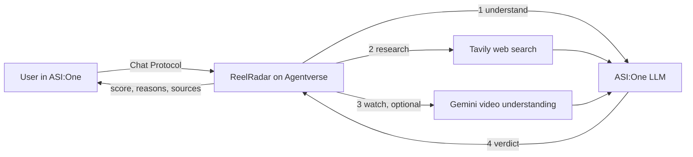

# ReelRadar: will this Instagram Reel work?


Built for **Fetch-a-thon 3.0 (ASI:One Agent Challenge)**.

ReelRadar is an Agentverse agent you chat with in ASI:One. Ask whether a Reel idea will work, or what is trending in your niche. It researches the live web, optionally watches your video, and answers with a score, reasons, improvements, three hook options and cited sources.

## Agent details

| | |
|---|---|
| Agent name | ReelRadar |
| Handle | `[@handle]` |
| Agent address | `[agent1q...]` |
| Agentverse profile | `[profile URL]` |
| ASI:One shared chat | `[shared chat URL]` |
| Hosting | Agentverse hosted agent (single file, `agent.py`) |
| Protocol | Agent Chat Protocol |

## What it does

- **Verdict on an idea:** score out of 100, verdict (likely to work, could work with changes, unlikely to work), confidence level, reasons, improvements and 3 hook options.
- **Trend briefing:** current Reels formats, hooks and ranking signals for a niche, each cited to a numbered source.
- **Watches video:** analyses a public YouTube/Shorts link or an uploaded video or screenshot (about 14 MB max) and critiques the hook, pacing, text, audio and retention risks.
- **Honest by design:** trend claims must cite a search result. If live research is unavailable it says so and lowers confidence. Scores are estimates, never promises.

### Example questions

- Will a "day in my life as a nurse" reel work right now?
- What Instagram Reels formats are trending for home workouts?
- Review this reel: `https://www.youtube.com/shorts/...`
- Here is my video, will it perform? (attach the file)

## How it works



1. ASI:One's model reads the question and plans the searches.
2. Tavily returns current articles about Reels trends and the algorithm.
3. If media is attached, Gemini describes only what it sees and hears.
4. ASI:One combines the snippets and the video notes into a JSON verdict, which the agent renders as a markdown answer with a numbered source list.

If a step fails, the agent still replies: it reports what it could not do and never leaves the user without an answer. Each user is limited to 12 requests per hour to protect the free API quotas.

## Run it yourself

ReelRadar is one file, built to run as an **Agentverse hosted agent**.

1. Get a free [Tavily](https://tavily.com) API key and a [Gemini](https://aistudio.google.com/apikey) API key.
2. In Agentverse, create a hosted agent named ReelRadar.
3. In the **Build** tab, replace the code with `agent.py` from this repository.
4. In **Agent Secrets**, add:

| Secret | Purpose | If missing |
|---|---|---|
| `ASI1_API_KEY` | ASI:One reasoning model (Agentverse injects it into hosted agents; add it only if it is absent) | The agent cannot answer |
| `TAVILY_API_KEY` | Live trend research | Answers are labelled as not based on current data, with low confidence |
| `GEMINI_API_KEY` | Watches video and images | Video and image input is ignored with a notice |
| `GEMINI_MODEL` | Optional model override (default `gemini-3.8-flash`, falls back to `gemini-2.5-flash`) | Default used |

5. Start the agent, paste `AGENTVERSE_README.md` into the Overview tab, set a handle, and open **Chat with Agent**, or use the handle in ASI:One with the Agents toggle on.

## Tests

The unit tests mock every network call (ASI:One, Tavily, Gemini, Agentverse storage), so they need no keys.

```bash
pip install -r requirements.txt
python -m unittest discover -s tests -v
```

They cover the research, verdict and trend paths, the missing-key notices, partial search failures, bad model output, upload handling and size limits, YouTube link detection, the chat handler and the rate limit.

## Limits

- It cannot open Instagram links, because Instagram blocks automated access. Upload the file or share a public YouTube link.
- Scores are estimates based on public web research and your input, not Instagram analytics.
- Uploads over about 14 MB are refused. Whether a given ASI:One chat surface allows video uploads is outside this agent's control.
- The `gemini-3.8-flash` default follows Google's current documentation; set `GEMINI_MODEL` if Google returns an error for it.

## Repository layout

```
agent.py                  the agent (Chat Protocol, research, video analysis)
AGENTVERSE_README.md      text to paste into the Agentverse Overview tab
DESCRIPTION.md            written project description
tests/test_agent.py       mocked unit tests
requirements.txt          dependencies for running the tests locally
```